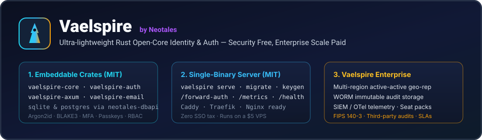
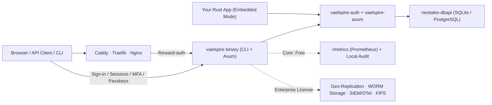

<p align="center">
  
</p>

<h1 align="center">🐉 Vaelspire</h1>

<p align="center">
  <strong>Ultra-lightweight Rust identity &amp; authentication platform by Neotales.</strong><br/>
  Embed it like <em>Better Auth</em> in your Rust app, or deploy one fast binary in front of every service.
</p>

<p align="center">
  <a href="LICENSE"></a>
  <a href="LICENSE-ENTERPRISE"></a>
  
  
</p>

---

## ✨ Why Vaelspire?

Most identity vendors lock basic security behind enterprise price walls ("the SSO tax") or force you to babysit a multi-container JVM/Python stack just to authenticate users.

**Vaelspire flips that model:**

- 🛡️ **Security is 100% free — forever.** Passwords (Argon2id + legacy bcrypt auto-upgrade), keyed BLAKE3 session digests, TOTP MFA, Passkeys/WebAuthn, API keys, CSRF/origin guards, RBAC, and transactional audit trails all live in the **MIT-licensed Open-Core**.
- ⚡ **Ultra-lightweight Rust core.** Zero GC pauses, `#![forbid(unsafe_code)]`, tiny memory footprint, and `spawn_blocking` Argon2 so login bursts never stall your async workers.
- 🧩 **Two ways to adopt, one codebase:**
  1. **Embed directly in your Rust app** (no extra service to run!) using modular `vaelspire-*` crates over `neotales-dbapi`.
  2. **Run one static `vaelspire` binary** in front of *any* stack (Rust, Go, Node, Python, Vaelsgard) via `/forward-auth` (Caddy / Traefik / Nginx) or HTTP API.
- 🏢 **Pay only when you scale globally or enter regulated compliance.** Multi-region geo-replication, WORM immutable audit storage, real-time SIEM/OpenTelemetry pipelines, multi-year retention, seat packs, and FIPS 140-3 builds live cleanly in **Vaelspire Enterprise**.

---

## 🏗️ Architecture at a Glance



---

## 🚀 60-Second Quickstart

### Option 1: Run the Standalone `vaelspire` Server (Zero External DB Required)

```bash
# 1. One-command local setup (generates .env + auth key + SQLite DB)
./scripts/dev-setup.sh

# 2. Build and launch Vaelspire on http://127.0.0.1:8080
./scripts/quickstart.sh

# 3. Verify health, metrics, sign-in, and /forward-auth end-to-end
./scripts/smoke-test.sh
```

Or run directly with Cargo:

```bash
# Generate a 256-bit hex key for BLAKE3 session & token digests
export VAELSPIRE_AUTH_KEY=$(cargo run -p vaelspire -- keygen)
export VAELSPIRE_ADMIN_EMAIL="admin@example.test"
export VAELSPIRE_ADMIN_PASSWORD="change-me-in-production"

# Boot the single-binary server with embedded SQLite
cargo run -p vaelspire -- serve --bind 127.0.0.1:8080 --sqlite ./vaelspire.sqlite
```

Put **any** backend app behind Vaelspire in Caddy with 3 lines:

```caddyfile
app.example.com {
    forward_auth 127.0.0.1:8080 {
        uri /forward-auth
        copy_headers X-Vaelspire-User-Id X-Vaelspire-Email X-Vaelspire-Tenant-Id
    }
    reverse_proxy 127.0.0.1:3000
}
```

### Option 2: Embed Directly in Your Own Rust + Axum App (No Extra Service)

Add `vaelspire-core`, `vaelspire-auth`, `vaelspire-axum`, and `vaelspire-store-sqlite` (or `vaelspire-store-postgres`):

```rust
use std::sync::Arc;
use axum::Router;
use vaelspire_axum::AuthRouter;
use vaelspire_core::{AuthStore, Id, Timestamp};
use vaelspire_store_sqlite::open;

#[tokio::main]
async fn main() -> Result<(), Box<dyn std::error::Error>> {
    // 1. Open and migrate SQLite via neotales-dbapi + neotales-migration
    let store = Arc::new(open("app.sqlite").await?);

    // 2. Ensure a tenant exists (seeded with owner, admin, member roles)
    let tenant = Id::now_v7();
    store.create_tenant(tenant, "my-app", Timestamp::now_utc()).await?;

    // 3. Load a persistent 32-byte key from your secret store (never hardcode in prod)
    let digest_key: [u8; 32] = load_secret_key_from_env();

    // 4. Mount fail-closed auth routes (cookie_secure is an explicit choice)
    let auth = AuthRouter::new(Arc::clone(&store), tenant, digest_key, true)
        .allowed_origins(["https://app.example.com"])
        .auditing(true)
        .roles(true)
        .api_keys(Some("vsp"))?
        .on_proof(|email, kind, token| {
            // Deliver verification / reset / invitation token via vaelspire-email. Never log it.
            let _ = (email, kind, token);
        })
        .into_router();

    let app = Router::new().nest("/auth", auth);
    let listener = tokio::net::TcpListener::bind("127.0.0.1:3000").await?;
    axum::serve(listener, app).await?;
    Ok(())
}
```

---

## 📦 Workspace Crates (MIT Open-Core)

| Crate | Purpose | Key Capabilities |
| :--- | :--- | :--- |
| [**`vaelspire`**](crates/vaelspire/README.md) | Single-binary CLI + HTTP Server | `serve`, `migrate`, `admin bootstrap`, `keygen`, `/forward-auth`, `/metrics`, `/health` |
| [**`vaelspire-core`**](crates/vaelspire-core/README.md) | Zero-I/O Contracts | `AuthStore` trait, `Id` (`UUIDv7`), `AuthError`, `User`, `Session`, `ApiKey`, `AuditEvent` |
| [**`vaelspire-auth`**](crates/vaelspire-auth/README.md) | Embeddable Auth Engine | Argon2id + bcrypt upgrade, BLAKE3 keyed digests, sessions, TOTP MFA, Passkeys, API keys, RBAC |
| [**`vaelspire-axum`**](crates/vaelspire-axum/README.md) | Axum 0.8 HTTP Router | Fail-closed cookies, origin allow-list, double-submit CSRF, `spawn_blocking` Argon2, social/OIDC client |
| [**`vaelspire-email`**](crates/vaelspire-email/README.md) | Vendor-Neutral Delivery | Async `Sender` trait (accepts closures) + optional rustls `SmtpSender` (`lettre`) |
| [**`vaelspire-store-sqlite`**](crates/vaelspire-store-sqlite/README.md) | Embedded SQLite Store | `neotales-dbapi` + `neotales-migration`, transactional audit & immutability triggers |
| [**`vaelspire-store-postgres`**](crates/vaelspire-store-postgres/README.md) | PostgreSQL 17+ Store | `neotales-dbapi-postgres` + advisory-locked migrations, shared `conformance.rs` suite |

---

## 💎 Vaelspire Core vs. Vaelspire Enterprise

We don't charge for basic security. **Vaelspire Core** gives startups, indie hackers, and self-hosters everything needed to run rock-solid authentication in a single region for free.

When your organization needs **global low-latency replication, regulated immutable storage, enterprise observability, or formal compliance attestations**, **Vaelspire Enterprise** unlocks those capabilities with zero migration pain:

| Capability | 🆓 Vaelspire Core (MIT) | 🚀 Pro / Growth | 🏢 Vaelspire Enterprise |
| :--- | :--- | :--- | :--- |
| **Core Security** *(Argon2id, MFA, Passkeys, Sessions, API Keys, RBAC, CSRF)* | ✅ **100% Free** | ✅ Included | ✅ Included |
| **Deployment Footprint** | Ultra-lightweight single binary, 1 region | Up to 2–3 regions (read replicas / failover) | **Unlimited regions** — active-active geo-replication & EU/US/APAC residency pinning |
| **Audit Data** | Transactional append-only local audit log | Extended retention (90–365d) & exports | **Multi-year retention (1–7+ yrs)**, cryptographic hash-chaining, auditor portal |
| **WORM Immutable Storage** | — | — | **S3 Object Lock, Azure Immutable Blob, GCS Bucket Lock** *(SEC 17a-4 / FINRA / HIPAA)* |
| **Telemetry & SIEM** | Prometheus `/metrics` + structured JSON logs | OpenTelemetry traces/metrics + webhooks | **Real-time SIEM sinks** *(Splunk, Datadog, Sentinel, CrowdStrike, Kafka)* |
| **Licensing & Enforcement** | Unlimited single-region community use | Workforce seat packs | Volume workforce seats + CIAM MAU packs, **offline Ed25519 air-gapped keys** *(never bricks logins on expiry)* |
| **Compliance & Support** | Audited standard crypto + OIDC Conformance CI | Priority patches & SLA | **FIPS 140-3 builds**, third-party pen-test/audit reports (NDA), SOC 2 / ISO packages, dedicated SLA |

> 💼 **Interested in Vaelspire Enterprise, Managed Cloud, or an early design-partner seat?**
> See [enterprise/README.md](enterprise/README.md) and [LICENSE-ENTERPRISE](LICENSE-ENTERPRISE), or open a discussion on GitHub to talk with Neotales.

---

## 📚 Documentation & AI Agent Reference

Vaelspire ships an **Astro Starlight** documentation and product site in [`docs/`](docs/):

- **For humans:** Quickstarts, reverse-proxy guides (Caddy, Traefik, Nginx), crate walkthroughs, security architecture, and Enterprise packaging.
- **For AI coding agents:** Dedicated high-density reference pages (`/agents/`, `/agents/api-reference/`, `/agents/crate-recipes/`) plus standard [`/llms.txt`](docs/public/llms.txt) and [`/llms-full.txt`](docs/public/llms-full.txt) endpoints so agents can integrate Vaelspire without guessing.

```bash
cd docs && pnpm install && pnpm dev
```

---

## 🧪 Local Verification

```bash
cargo fmt --all -- --check
cargo clippy --workspace --all-targets --offline -- -D warnings
cargo test --workspace --exclude vaelspire-store-postgres --exclude vaelspire-email
```

*(PostgreSQL and Mailpit integration tests run via `testcontainers` when Docker is available; `--all-features` adds `passkey` and Postgres TLS via OpenSSL.)*

---

## 📜 Licensing

- **Open-Core** (`/` outside `enterprise/`): [MIT License](LICENSE)
- **Enterprise** (`enterprise/` and Enterprise-marked modules): [Vaelspire Enterprise License](LICENSE-ENTERPRISE)
